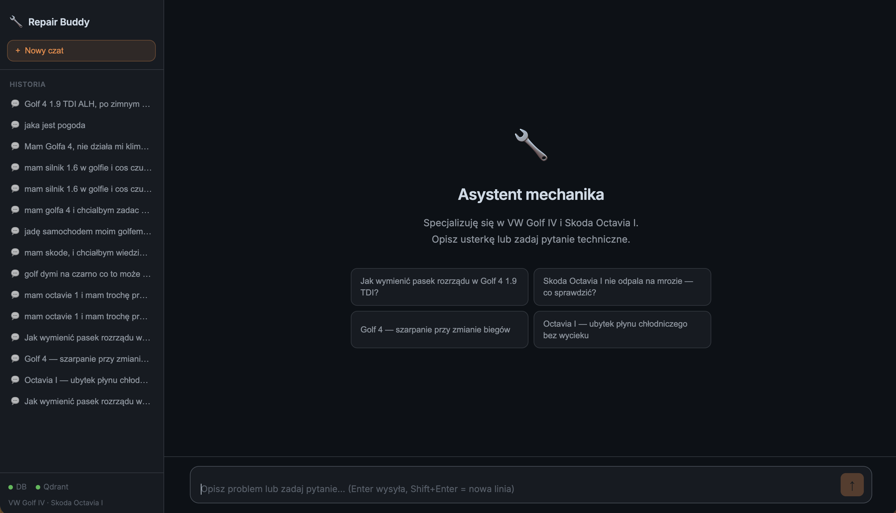
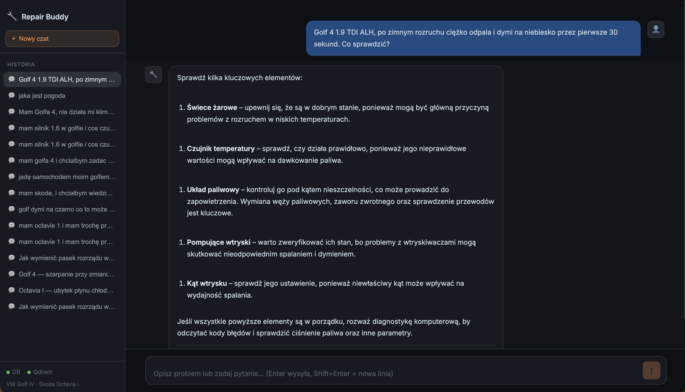
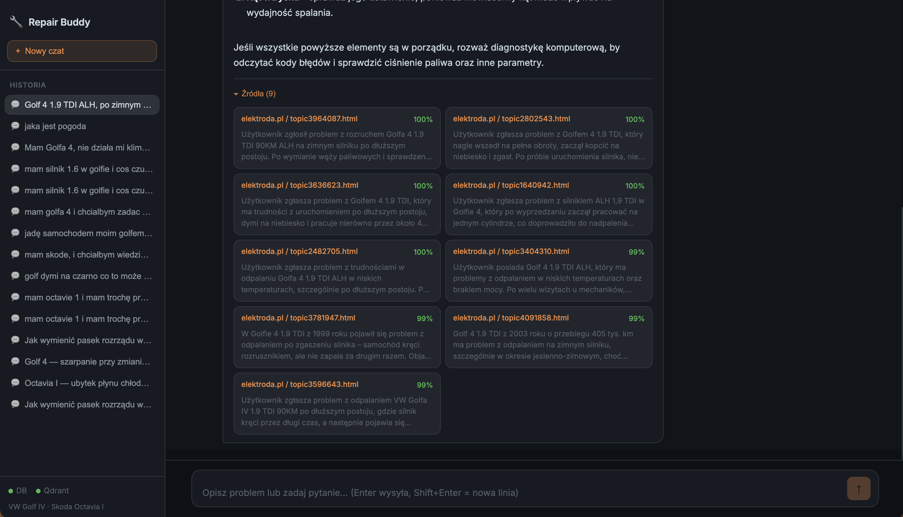
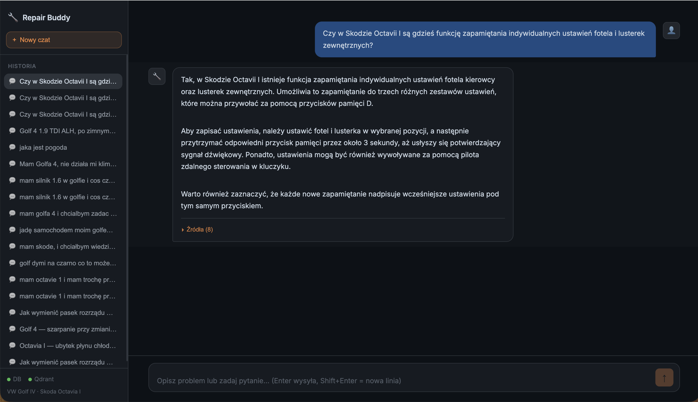
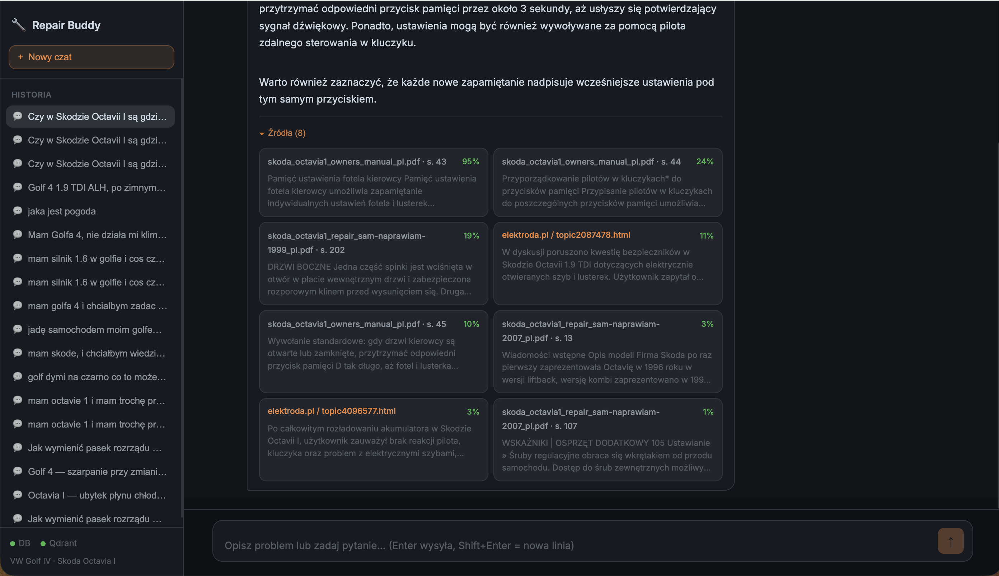
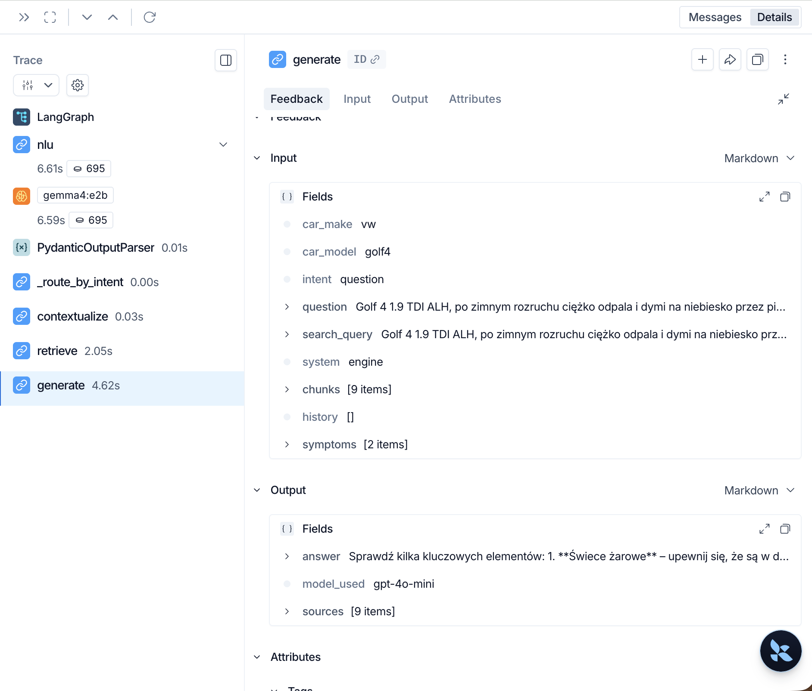
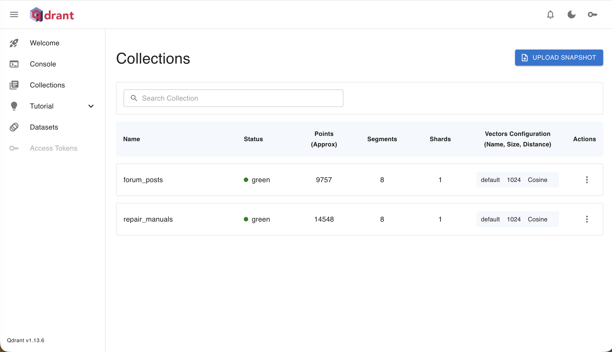
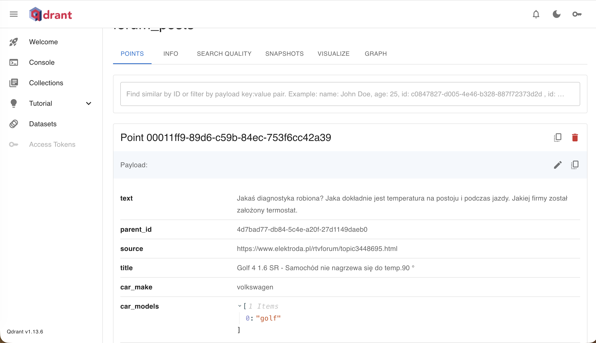
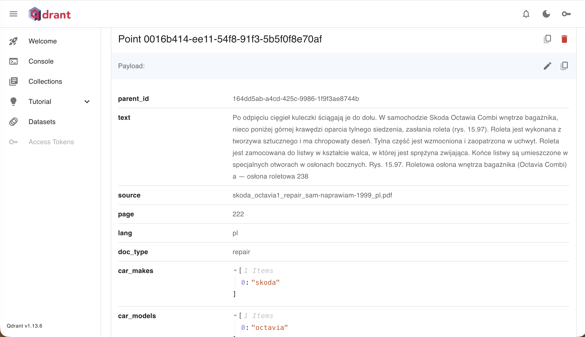

# Repair Buddy

A conversational diagnostic assistant for two cars we could get good source material for: **VW Golf IV**
and **Škoda Octavia I**. You describe a fault in plain language and it answers from real workshop
manuals and forum threads, with the sources it used. It tracks the car across turns, so follow-up
questions stay in context.

Built for the Dialogue Systems course at Adam Mickiewicz University by Jan Kordas and Jakub Zaręba.

The backend is the project: a LangGraph RAG pipeline with parent/child retrieval, a cross-encoder
reranker, and slot-based dialog state. It runs locally by default; answer generation can be pointed at
Groq or OpenAI.

> The chat UI is in Polish (the users would be Polish mechanics). Captions below explain what's on
> screen.

## Screenshots



Landing screen. The sidebar keeps recent conversations and shows live Postgres and Qdrant health; the
chips are example questions. "Asystent mechanika" means "mechanic's assistant".

### Example 1: a forum-grounded fault



A real question: "Golf 4 1.9 TDI ALH, hard to start after a cold start and blows blue smoke for the
first 30 seconds. What should I check?" The answer is an ordered checklist grounded in the retrieved
sources: glow plugs, coolant-temperature sensor, fuel system and air ingress, injector pump,
injection timing, then a suggestion to read fault codes. It does not answer from general knowledge.



Expanding "Źródła" (Sources) shows the nine threads behind that answer, each with the cross-encoder
relevance score (99-100% here) and a snippet, linking back to the original elektroda.pl thread.

### Example 2: a specific fact from a manual



A different kind of question, answered from the PDFs rather than the forum: "Does the Škoda Octavia I
have a function to store individual seat and exterior-mirror settings?" It explains the memory feature:
up to three presets on the D memory buttons, hold a button about three seconds until the confirmation
beep to store, recall from the remote in the key, and each save overwrites the previous one under the
same button.



The sources for that answer. The top hit is page 43 of the Škoda owner's manual at 95%, far ahead of
the rest. This is parent/child retrieval pulling one paragraph out of a ~200-page PDF, with the page
number carried through so the answer stays checkable.

### One request, traced



A LangSmith trace of one request. On the left, the LangGraph nodes with per-node latency
(`nlu`, `contextualize`, `retrieve`, `generate`). On the right, the state at `generate`: the slots NLU
parsed (`car_make=vw`, `car_model=golf4`, `system=engine`, two symptoms), the rewritten `search_query`,
the nine retrieved chunks, and `model_used=gpt-4o-mini`.

## What it demonstrates

- **Parent/child retrieval.** Small children (~250 tokens) are embedded and matched for precision, but
  the larger parent (~1200 tokens) is what goes to the LLM. Children live in Qdrant, parents in
  Postgres, linked by `parent_id`.
- **Reranking that gates the answer.** A `BAAI/bge-reranker-v2-m3` cross-encoder rescores the
  candidates against a relevance threshold. If nothing clears it, the model is told there is no match
  instead of guessing.
- **Retrieval filtered by dialog state.** An NLU node fills slots (car, system, symptoms) that persist
  in Postgres across turns and become Qdrant payload filters, so "how long does that take?" stays
  scoped to the right car.
- **Intent routing.** Greetings and off-topic messages get canned replies, recap questions are
  answered from history, and a missing car is requested before retrieval runs.
- **Local by default, swappable where it matters.** Ollama for the LLM and embeddings, Qdrant,
  Postgres. Generation swaps to Groq or OpenAI with one env var; the reranker runs in-process, via a
  native llama.cpp server, or off.

## How it works

Each `/chat` request runs through a LangGraph pipeline:

1. **NLU** pulls intent and slots (car make, model, system, symptoms) from the message and merges them with slots carried from earlier turns.
2. The graph **routes on intent**: `greeting`/`off_topic` get a canned reply, `recap` is answered from history, and if no car is known yet it asks for one. Otherwise it goes to retrieval.
3. **Contextualize** rewrites the message into a standalone query (resolving "it", "this", and so on from history) and folds in the accumulated symptoms, so retrieval targets the fault and not just the car.
4. **Retrieve** embeds the query and searches both Qdrant collections for matching children, filtered by the tracked car. The cross-encoder reranks them (see [Reranker modes](#reranker-modes)), anything below the threshold is dropped, the rest are deduplicated by parent, and the parent chunks are fetched from Postgres.
5. **Generate** sends the parent chunks plus recent history to the answer model. If nothing cleared the threshold, the model is told the knowledge base has no match rather than answering from general knowledge.

Slots are stored in `conversations.slots`, which is what keeps a follow-up like "how long will it take?" scoped to the same car.

## Data

The knowledge base comes from two real sources. Neither is in the repo; what's here is the pipeline
that builds them.

- **~19 repair manuals (PDF)**: Haynes, the Bentley factory manual, VW Self-Study Programmes, the
  Polish "Sam Naprawiam" series, and assorted workshop and wiring documents. Polish, English and
  French. These are copyrighted, so `data/raw/` is empty.
- **841 forum threads** from [elektroda.pl](https://www.elektroda.pl): real questions and answers from
  Polish owners and mechanics, cleaned and summarized at ingest time. Not redistributable, so the
  scraper output is not committed.

After ingestion these land in two Qdrant collections, 1024-dim cosine: `repair_manuals` (14,548
vectors) and `forum_posts` (9,757 vectors).



## A note on the frontend

**The frontend (`frontend/`) is completely vibe-coded and is not part of the project.** It's a
throwaway React/Vite UI whose only job is to make the backend clickable instead of curl-only, so the
pipeline can be demoed and screenshotted. Judge the backend, not this.

## Stack

- FastAPI + LangGraph + LangChain
- Qdrant for vectors
- Postgres for app data and parent chunks (async SQLAlchemy + Alembic)
- Cross-encoder reranker (BGE-reranker-v2-m3) over retrieved candidates: in-process, via a native llama.cpp server, or disabled (see [Reranker modes](#reranker-modes))
- Ollama for the local LLM and embeddings; optional Groq or OpenAI for answer generation

## Requirements

- Docker + Docker Compose
- Ollama running locally on port `11434`
- Optional: llama.cpp running locally on port `8081` for fast reranking (see [Reranker modes](#reranker-modes))

## Setup

Pull the local models:

```bash
ollama pull qwen3-embedding:0.6b   # embeddings
ollama pull gemma3:4b              # NLU + (optional) local answer generation
```

You can switch models via `OLLAMA_CHAT_MODEL`, `OLLAMA_NLU_MODEL`, `OLLAMA_EMBEDDING_MODEL` in `.env`.

For faster answers, set `GENERATE_PROVIDER=groq` (or `openai`) and the matching API key in `.env`. Groq has a free tier that covers normal usage.

Run the stack:

```bash
docker compose up --build
```

Apply DB migrations:

```bash
cd backend
uv run alembic upgrade head
```

Prepare and ingest the data (bring your own PDFs, see [Data](#data)):

```bash
cd backend
uv run python scripts/prepare_dataset.py   # OCR scanned PDFs into data/processed/
uv run python scripts/ingest.py            # chunk + embed PDFs and forum into Qdrant
```

`prepare_dataset.py` is idempotent: re-running only processes new files. `ingest.py` rebuilds both Qdrant collections; see [Data ingestion](#data-ingestion) for selective re-ingest.

Frontend is at `http://localhost:3000`, API at `http://localhost:8000`, Adminer (DB browser) at `http://localhost:8080`.

### Reranker modes

Retrieved candidates are reranked by `BAAI/bge-reranker-v2-m3` (a multilingual cross-encoder that handles Polish well). `RERANKER_MODE` in `.env` selects how it runs:

| Mode | What runs | Speed | Notes |
|------|-----------|-------|-------|
| `llamacpp` | native `llama-server` on the host (Metal GPU) | ~1-2 s for 24 candidates | recommended on Apple Silicon; falls back to vector order (no scores) if the server is unreachable |
| `local` | CrossEncoder inside the backend container (CPU) | ~1 s per candidate | no extra services, but Docker on macOS has no GPU access; adds ~1 GB RAM to the container |
| `off` | nothing | instant | chunks keep Qdrant vector-score order; `RELEVANCE_THRESHOLD` is not applied |

For `llamacpp` mode, install and start the server (first run downloads the ~600 MB GGUF):

```bash
brew install llama.cpp
llama-server -hf gpustack/bge-reranker-v2-m3-GGUF:Q8_0 --rerank --port 8081 -ub 4096 -b 4096 -c 8192
```

`-ub`/`-b` raise the physical/logical batch from the 512-token default; without them llama-server returns HTTP 500 when the combined query + document token count of any single candidate exceeds 512, which long forum posts routinely do. `-c` widens the context window for the same reason. The backend logs the 500 and falls back to Qdrant vector order (no scores), so you'll see a chat answer with sources but no relevance percentages. That's the signal you forgot the flags.

llama.cpp returns raw logits; the backend sigmoid-normalizes them to `[0,1]` so `RELEVANCE_THRESHOLD` means the same in both `llamacpp` and `local` modes.

Tuning knobs in `.env`:

- `RETRIEVAL_TOP_K`: candidates fetched per Qdrant query before reranking (in `local` mode this directly sets latency, about 1 s per candidate on CPU)
- `RERANKER_TOP_K`: chunks passed to the answer model after reranking
- `RELEVANCE_THRESHOLD`: chunks scoring below this are dropped before generation

### Optional: LangSmith tracing

The trace screenshot above comes from LangSmith. Set the `LANGSMITH_*` variables in `.env` (see `.env-example`) to get per-node traces at https://smith.langchain.com. Recreate the backend container after editing `.env`:

```bash
docker compose up -d backend --force-recreate
```

`docker compose restart` does not reload `.env`.

## Endpoints

| Method | Path | Description |
|--------|------|-------------|
| GET | `/health` | app status |
| GET | `/health/qdrant` | Qdrant status |
| GET | `/health/ollama` | Ollama status |
| GET | `/health/postgres` | Postgres status |
| POST | `/chat` | ask a question; optional `conversation_id` for multi-turn |
| GET | `/conversations/{id}/messages` | message history for a conversation |

## Local development

```bash
cd backend
uv sync
uv run uvicorn app.main:app --reload
```

Lint and format with ruff:

```bash
uv run ruff check .
uv run ruff format .
```

### Database migrations

After changing models in `app/models/`:

```bash
uv run alembic revision --autogenerate -m "describe change"
uv run alembic upgrade head
```

Rollback last migration:

```bash
uv run alembic downgrade -1
```

### Data ingestion

Two stages: prepare PDFs once, then ingest into Qdrant whenever the sources change.

**Stage 1, `scripts/prepare_dataset.py`** reads `data/raw/` and writes `data/processed/`. PDFs with a text layer are copied as-is. Scanned PDFs go through `ocrmypdf` with the language inferred from the filename suffix (`_pl.pdf`, `_en.pdf`, `_fr.pdf`). Files already in `data/processed/` are skipped.

Requires:

```bash
brew install ocrmypdf tesseract-lang
```

**Stage 2, `scripts/ingest.py`** chunks and embeds the data into Qdrant. Two collections:

| Collection | Source | Chunking |
|------------|--------|----------|
| `repair_manuals` | `data/processed/*.pdf` | tokenizer-aware macro/micro split (Qwen tokenizer); ~1200-token parents to Postgres `chunk_parents`, ~250-token children to Qdrant with `parent_id` |
| `forum_posts` | `elektroda_scraper/output/threads.jsonl` | parent per thread (AI summary or title) to Postgres `chunk_parents`; one micro per AI summary plus one per cleaned post to Qdrant with `parent_id` |

Every child vector carries the payload used to link it back and to filter retrieval. A forum child keeps `parent_id`, the source URL, the thread title, and the car make/model:



A manual child has the same shape plus `page`, `lang` and `doc_type`. Below, page 222 of a Polish Škoda Octavia repair manual, tagged `skoda`/`octavia`:



By default both collections are rebuilt. To re-ingest only one:

```bash
uv run python scripts/ingest.py --only pdfs
uv run python scripts/ingest.py --only forum
```

To scrape more forum threads, discover thread URLs (searches elektroda for the configured topics, appending to `urls.txt`) then scrape their content (very likely to be throttled by elektroda's anti-bot measures):

```bash
cd elektroda_scraper
uv run python gather_urls.py        # discover + append URLs to urls.txt
uv run python main.py urls.txt      # scrape thread content to output/threads.jsonl
```

## Limitations

- **Two cars only.** Retrieval is slot-filtered to Golf IV and Octavia I. Ask about anything else and there is nothing to ground on.
- **Answers are only as good as the sources.** Forum threads contain wrong answers and folklore; the reranker surfaces relevant text but does not fact-check it.
- **Latency is demo-grade.** End-to-end is about 35 s with OpenAI (local NLU, reranking, generation), not tuned for production.
- **Single-user local setup.** No auth and no automated tests; this is a portfolio project, not a deployment.
- **OCR quality varies** on scanned manuals, which affects what ends up retrievable.
